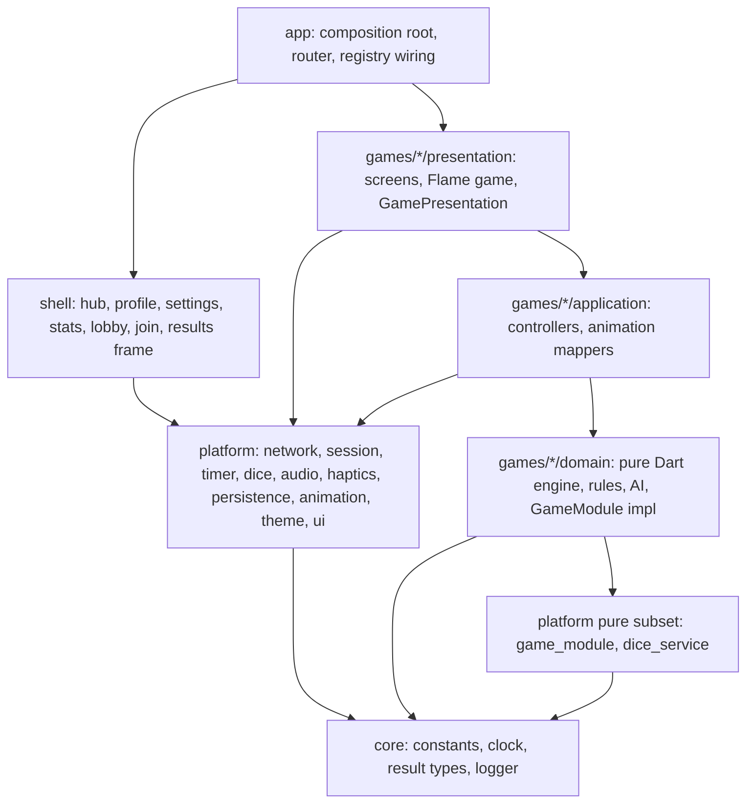
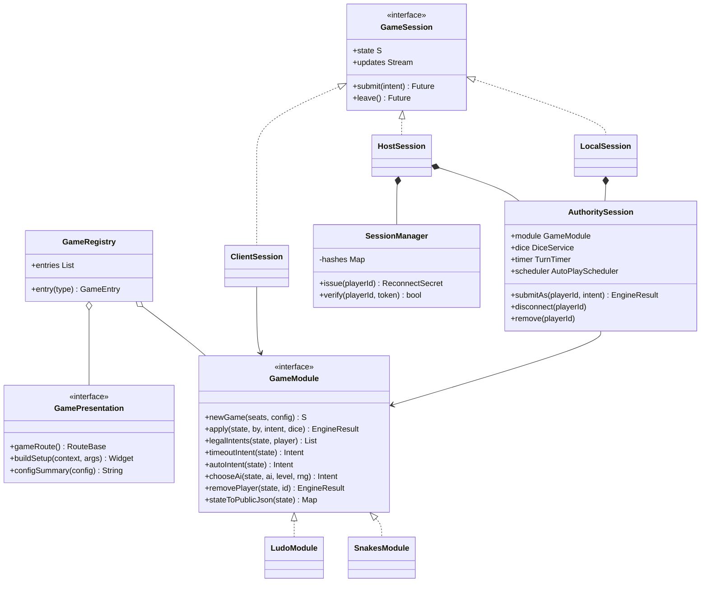
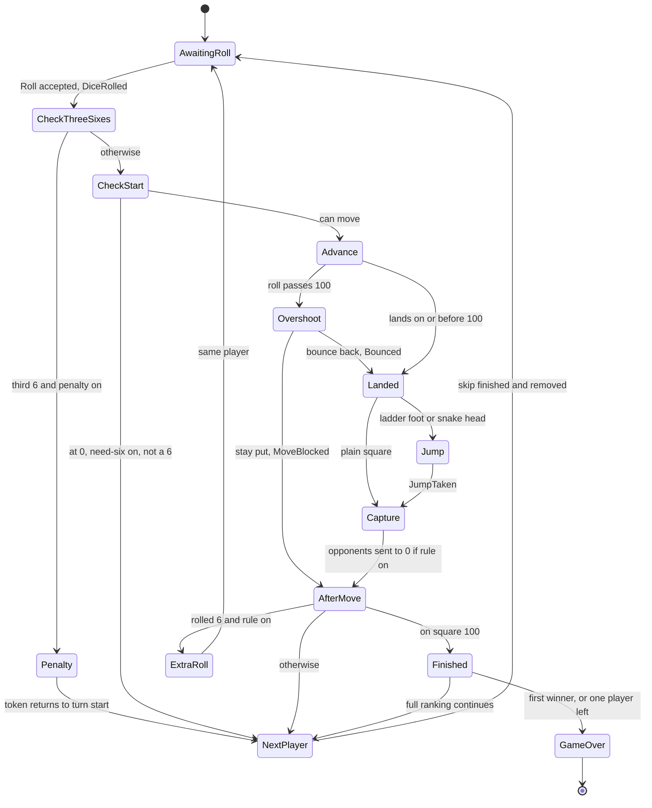
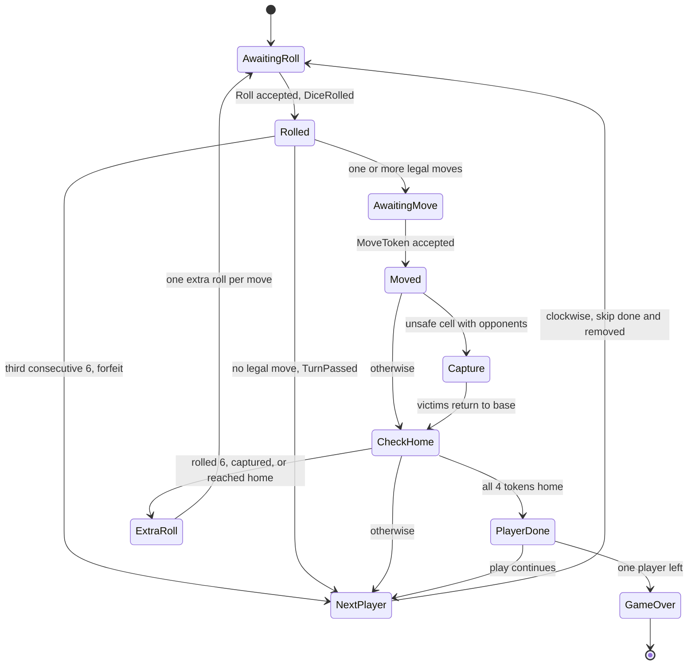
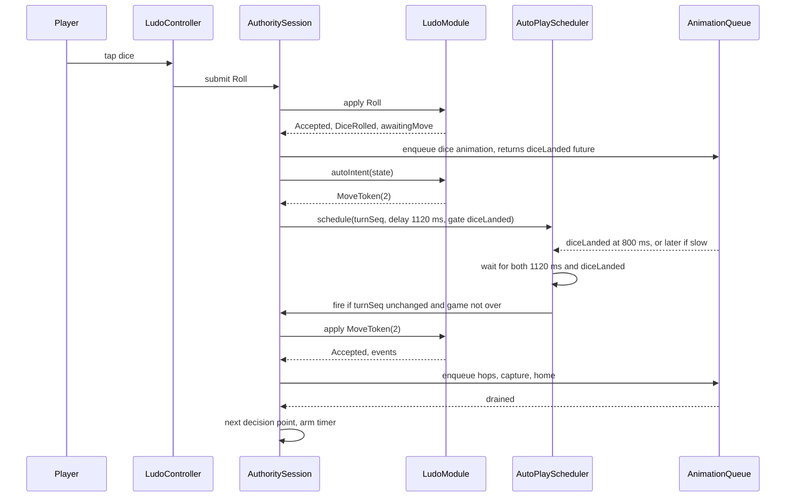
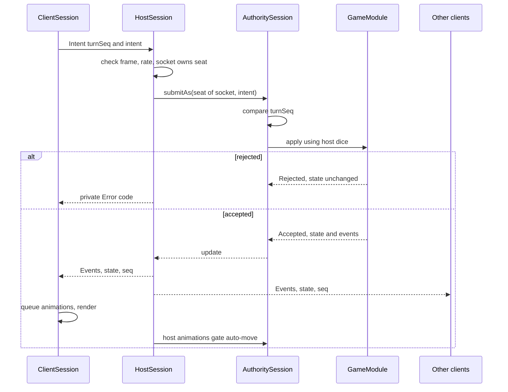
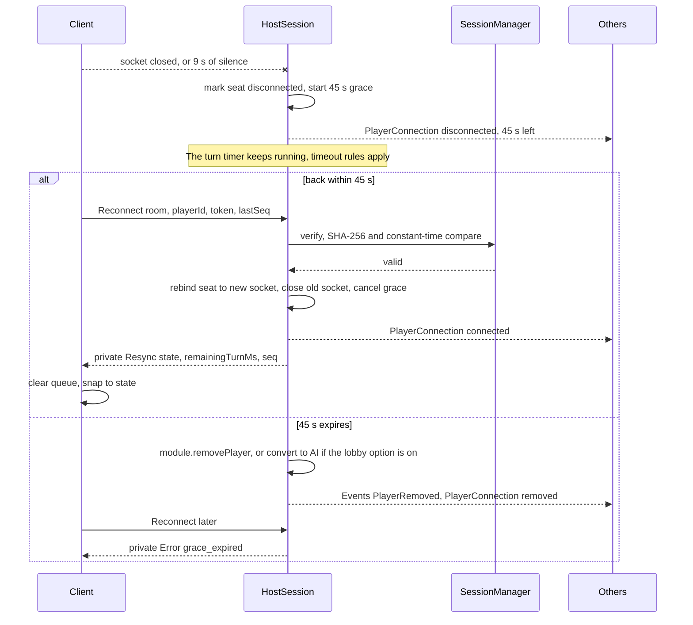
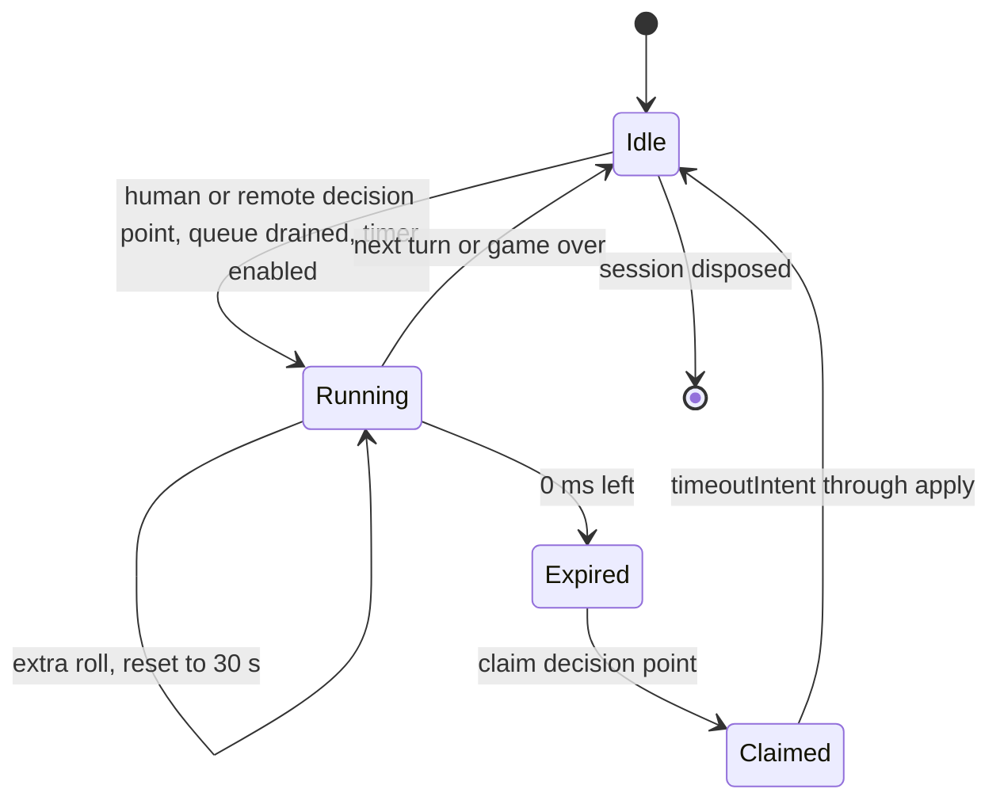
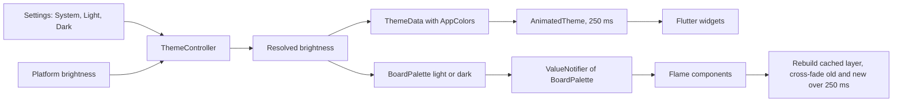

# Dice Party Architecture

Phase 1. One Flutter app, two board games (Snakes & Ladders and Ludo), one shared shell and one shared multiplayer platform. The wire format is in [PROTOCOL.md](PROTOCOL.md). Reasons for choices are in [DECISIONS.md](DECISIONS.md).

## 1. Stack

Versions were resolved together on Flutter 3.41.6 / Dart 3.11.4.

| Concern | Choice |
|---|---|
| UI | Flutter, Material 3 |
| Boards and in-board effects | `flame` 1.38.2 |
| State | `flutter_riverpod` 3.3.1, `riverpod_generator` 4.0.3 |
| Models | `freezed` 3.2.5, `json_serializable` 6.13.0 (generated files are committed) |
| Routing | `go_router` 17.5.0 |
| Network | `dart:io` `HttpServer` and `WebSocketTransformer` |
| Discovery | `nsd` 5.0.1, UDP beacon (Android only), `qr_flutter` 4.1.0, `mobile_scanner` 7.5.0 |
| Host addresses | `NetworkInterface.list`, with `network_info_plus` 8.2.2 as a hint (it returns null on a hotspot host) |
| Storage | `shared_preferences`, `flutter_secure_storage` 11.2.0, `path_provider` |
| Hashing | `crypto` 3.0.8 |
| Audio | `flame_audio` 2.12.2, behind an `AudioService` interface |
| Lints | `very_good_analysis` 10.2.0 (includes `public_member_api_docs`) |
| Tests | `flutter_test`, `fake_async`, `mocktail`, `matchesGoldenFile` |

Targets: Android API 24+, iOS 13+, portrait only. `web/`, `macos/`, `linux/` and `windows/` are unsupported.

## 2. Layers

Dependencies point downward only. `test/architecture/layering_test.dart` scans every import and fails on a violation.



Rules the test enforces:

- `games/*/domain` may import only `dart:core`, `dart:math`, `dart:collection`, `dart:convert`, annotation packages, `core/`, `platform/session/game_module.dart` and `platform/dice/dice_service.dart`. It may not import Flutter, Flame or `dart:io`.
- `shell/` never imports `games/`. It reaches games only through `GameRegistry`, so the shell has no game-specific branches.
- `games/snakes` and `games/ludo` never import each other.
- `platform/` never imports `shell/` or `games/`.

## 3. The GameModule contract

`GameModule` is pure. Everything needing Flutter is in `GamePresentation`. `GameRegistry` pairs them.

```dart
abstract interface class GameState {
  List<Player> get players;
  PlayerId? get currentPlayer;   // null once the game is over
  int get turnSeq;               // decision-point counter
  bool get isOver;
  List<PlayerId> get ranking;    // normal finishers, best first
  List<PlayerId> get leavers;    // removed seats, in leaving order
}

abstract interface class GameModule<S extends GameState, Intent, Event, Config> {
  GameType get type;                                  // snakes | ludo
  String get displayName;
  Config get defaultConfig;
  S newGame(List<SeatSpec> seats, Config config);

  EngineResult<S, Event> apply(S state, PlayerId by, Intent intent, DiceService dice);
  List<Intent> legalIntents(S state, PlayerId player);
  Intent? timeoutIntent(S state);                     // the game's timeout policy
  Intent? autoIntent(S state);                        // Ludo: the single legal move. S&L: always null
  Intent chooseAi(S state, PlayerId ai, AiLevel level, Random rng);
  Duration aiThinkDelay(AiLevel level, Random rng, {required bool fast});

  EngineResult<S, Event> removePlayer(S state, PlayerId id);
  S updatePlayer(S state, PlayerId id, Player Function(Player) update);
  Map<String, num> statsFor(S state, PlayerId id);

  Map<String, dynamic> stateToPublicJson(S state);    // never sees session secrets
  S stateFromJson(Map<String, dynamic> json);
  Codec<Intent> get intentCodec;                      // strict: unknown keys are malformed
  Codec<Event> get eventCodec;
  Codec<Config> get configCodec;
}

sealed class EngineResult<S, Event> {}
final class Accepted<S, Event> extends EngineResult<S, Event> {
  // state, events, signal
}
final class Rejected<S, Event> extends EngineResult<S, Event> {
  // the identical input state, RejectionCode code
}

enum TurnSignal { sameTurn, extraRoll, nextTurn, gameOver }

abstract interface class GamePresentation<Config> {
  GameType get type;
  RouteBase gameRoute();
  Widget buildSetup(BuildContext context, SetupArgs args);
  Widget buildResultsPanel(BuildContext context, ResultsArgs args);
  String configSummary(Config config);   // "Classic Sunshine · 7 snakes"
}
```

Validation always runs before any dice are drawn, so a rejected intent consumes no randomness and returns the same state object.



`AuthoritySession` is the single owner of engine calls, the turn timer, auto-moves and AI. `LocalSession` adds autosave. `HostSession` adds sockets, seats and reconnection. Because both wrap the same object, the 1120 ms behaviour cannot differ between local and Wi-Fi. `ClientSession` only decodes host messages and sends intents, and uses the module solely for codecs and `stateFromJson`.

## 4. Folder structure

```text
lib/
  main.dart
  app/            app.dart, router.dart, registry_setup.dart
  core/           constants/timing.dart, utils/, clock.dart, result.dart, logger.dart
  platform/
    dice/         dice_service, secure_dice_service, scripted_dice_service, seeded_dice_service
    timer/        turn_timer, auto_play_scheduler
    network/      protocol/ (envelope, messages, codec), ws_server, ws_client, discovery,
                  address_parser, heartbeat, rate_limiter, session_manager, host_session, client_session
    session/      game_module, game_state, game_registry, game_session, authority_session, local_session, ai_runner
    audio/ haptics/ persistence/ analytics/
    animation/    animation_queue, animation_gate
    theme/        app_colors, typography, spacing, theme_controller
    ui/           dice_widget, player_card, timer_ring, status_line, toasts
  shell/          splash/ hub/ game_menu/ profile/ settings/ stats/ lobby/ join/ results/ pause/ how_to_play/ widgets/
  games/
    snakes/
      domain/       board/ (board_def, jump, coords, validator), rules/, engine/, ai/, snakes_module.dart
      application/  snakes_controller, snakes_animation_mapper, board_repository
      presentation/ setup/, board_select/, game/, theme/board_palette, snakes_presentation.dart,
                    flame/ (snakes_game, board_component, snake_component, ladder_component, token_component, fx/)
    ludo/
      domain/       board/ (board_map, safe_cells, coords), rules/, engine/, timeout_policy.dart, ai/, ludo_module.dart
      application/  ludo_controller, ludo_animation_mapper
      presentation/ setup/, game/, theme/board_palette, ludo_presentation.dart,
                    flame/ (ludo_game, board_component, token_component, highlight_component, fx/)
assets/  shared/ games/snakes/ games/ludo/ audio/ fonts/ manifest.json
test/    architecture/ platform/ shell/ games/snakes/ games/ludo/ goldens/
docs/    AUDIT ARCHITECTURE PROTOCOL DECISIONS DEVICE_TEST
design/  wireframes.html asset_library.html
tool/    export_assets, generate_audio
```

Timing constants live only in `core/constants/timing.dart`: turn 30 s, auto-move 1120 ms, dice 800 ms, grace 45 s, heartbeat 3 s, silence limit 9 s.

## 5. Domain models

### Shared

```text
SeatSpec         { name, avatar, color, kind, aiLevel? }
Player           { id, name, avatar, color, kind, aiLevel?, connection, finishedRank?, stats }
PlayerKind       human | ai | remote
AiLevel          easy | normal
PlayerConnection local | connected | disconnected | removed
PlayerRemoved    { playerId, replacedByAi }
```

Final ranking is `ranking`, then any remaining unfinished players, then `leavers` reversed, so later leavers rank higher.

### Snakes & Ladders

```text
Jump        { id, type: ladder|snake, from, to, rank?, path? }
BoardDef    { id, name, theme, size, jumps, unlock; activeJumps(int snakeCount) }
SnakesRules { needSixToStart, overshoot: stay|bounce, extraRollOnSix, threeSixesPenalty, capture, playTo: firstWinner|fullRanking }
SnakesConfig{ boardId, snakeCount (6..8), rules }
SnakesState { boardId, rules, snakeCount, players, positions, current, phase: awaitingRoll|gameOver,
              lastRoll, consecutiveSixes, turnStartPosition, turnNumber, turnSeq, ranking, leavers }
Intent      Roll
Events      DiceRolled, TokenStepped, JumpTaken, MoveBlocked, Bounced, Captured, ExtraRoll,
            ThreeSixesPenalty, PlayerFinished, TurnPassed, GameOver
```

`SnakesModule` is constructed with the loaded `BoardDef`s, so the engine stays free of asset I/O. The application layer's `BoardRepository` reads the JSON. `activeJumps(n)` returns all ladders plus snakes ranked 1 to n, and it is the only source the engine and the board renderer use.

### Ludo

```text
Token     { id 0..3, color, rel -1..56 }
Move      { tokenId, fromRel, toRel, captures, leavesBase, reachesHome }
LudoState { players, tokens, current, phase: awaitingRoll|awaitingMove|gameOver, dice, sixesThisTurn, turnSeq, ranking, leavers }
Intent    Roll | MoveToken(tokenId)
Events    DiceRolled, TokenMoved(absolute cell path), TokenCaptured, TokenHome, ExtraRoll(reason),
          TurnPassed(reason), ThreeSixesForfeit, PlayerFinished, GameOver
```

### `turnSeq`

`turnSeq` increases by one on every accepted intent and on any seat removal that changes the current player. It identifies a decision point, so a duplicate tap, a stale network intent and a late timer callback all fail the same comparison.

## 6. Coordinates

- S&L square `n`: `row = (n-1) ~/ 10`, `c = (n-1) % 10`, `col = row.isEven ? c : 9 - c`, centre `((col+.5)/10, 1-(row+.5)/10)`. Position 0 is the start pad beside square 1.
- Ludo `(row, col)` maps to `((col+.5)/15, (row+.5)/15)`. Track absolute cell is `(start + rel) % 52` for rel 0 to 50.
- `stackOffsets(count)` in `platform/ui` returns the shared multi-token offsets.

## 7. State machines

### Snakes & Ladders turn

The whole of this diagram after `AwaitingRoll` runs inside one `apply` call. The events it emits are then animated in order.



### Ludo turn



A non-6 roll resets `sixesThisTurn`, so consecutive means consecutive rolls. A player who finishes does not use an extra roll.

## 8. Turn flows

### Local turn, Ludo single legal move



### Online turn



The acting player is always derived from the socket's bound seat, never from message content. The host's own seat calls `submitAs` directly.

### Disconnect, reconnect, removal



A valid `Reconnect` for a seat still marked connected takes over the seat. This handles half-open sockets, where the client's Wi-Fi dropped and the host has not yet seen 9 s of silence.

## 9. Timer and auto-action guards



Every automatic action (timer expiry, auto single-move, AI) passes through `AutoPlayScheduler`:

1. The action is bound to the `turnSeq` at scheduling time.
2. It fires at the later of `committedAt + delay` and the `diceLanded` gate.
3. At fire time, it is dropped if `state.turnSeq` differs or `state.isOver` is true.
4. Each `turnSeq` can be claimed once. If the timer expires while an auto-move is pending, the second claimant does nothing.
5. The action goes through `GameModule.apply` like any human intent.

AI seats do not arm the turn timer. If the timer expires before the roll, the auto-roll runs. Then the next decision point has a `timedOut` flag, which plays `timeoutIntent` after the dice gate instead of waiting for a tap.

If the host app is backgrounded, Flame stops ticking. `AnimationGate` therefore completes immediately on a lifecycle pause, so a game cannot stall on an animation nobody can see.

## 10. Rendering and animation

- Controllers map engine events to `AnimationStep`s through each game's animation mapper. `AnimationQueue` plays them in order. Input is enabled only when the queue has drained.
- Each board is cached as a `Picture` and invalidated only on resize or mode change.
- Snakes use one Catmull-Rom curve for both drawing and the slide path, read from the same `Jump.path`.
- Online, all peers use the host's animation speed. If a client's backlog exceeds two event batches, it plays the older batches at high speed so the display catches up.
- Reduce-motion replaces hops with short moves and disables confetti. The gates still complete normally.

## 11. Theme flow



Theme state is independent of game sessions, so switching cannot touch game state. Colours come only from `AppColors` and `BoardPalette`. A test scans `lib/` for colour literals outside the palette files.

## 12. Persistence and secrets

| Data | Store | Notes |
|---|---|---|
| Settings, profile, rule settings, stats, unlocks, last host | `shared_preferences` | |
| Saved local game, one per game | `shared_preferences` | `{schemaVersion, config, state}`, written at each decision point, silently discarded if unparsable |
| Online session | `flutter_secure_storage` | Game type, room, playerId, token, host. Cleared on game over or leave. |

The raw reconnect token exists only in the host's memory while the `Welcome` is being sent, in that `Welcome` frame, and on the owning client. It is wrapped in `ReconnectSecret`, which has no `toJson` and a redacted `toString`. `GameState` types have no field that could hold it.

## 13. Known limits

- iOS suspends backgrounded apps. A backgrounded iOS host stops serving, and clients see "Host lost". A backgrounded client reconnects when resumed, if within 45 s.
- Android and iOS hotspot behaviour varies by device and carrier. Bonjour may fail on hotspots, which is why QR and manual entry exist.
- Room codes identify a room and are not passwords. Anyone on the same network can see and join an open room.
- Seams for later work are no-ops in v1: `AnalyticsSink`, and an `AdSlot` at the Results screen.
